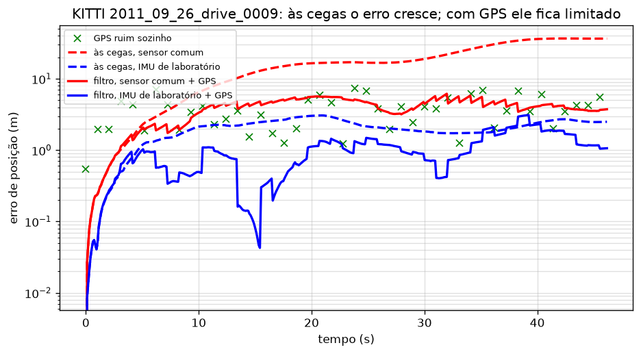
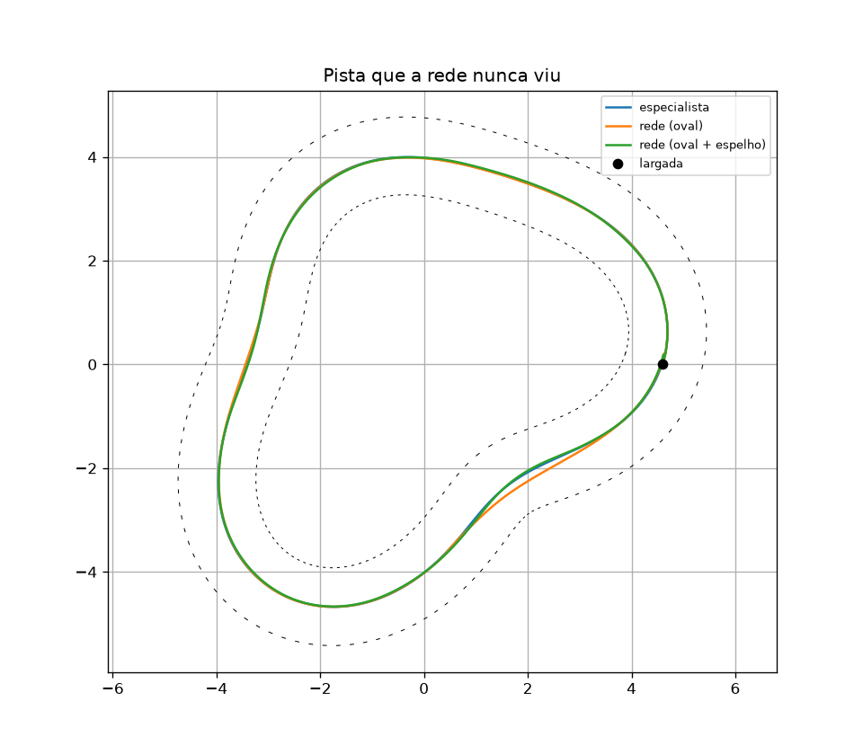
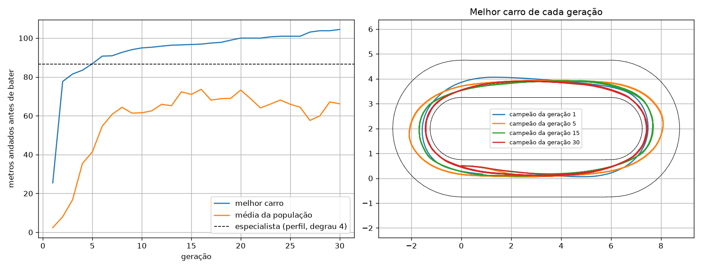
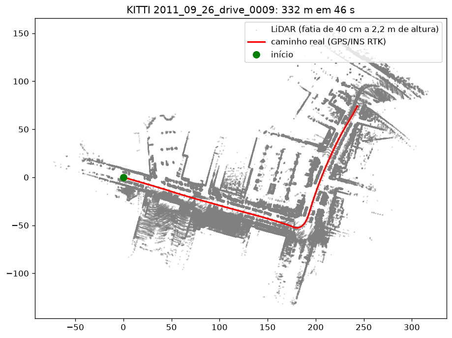
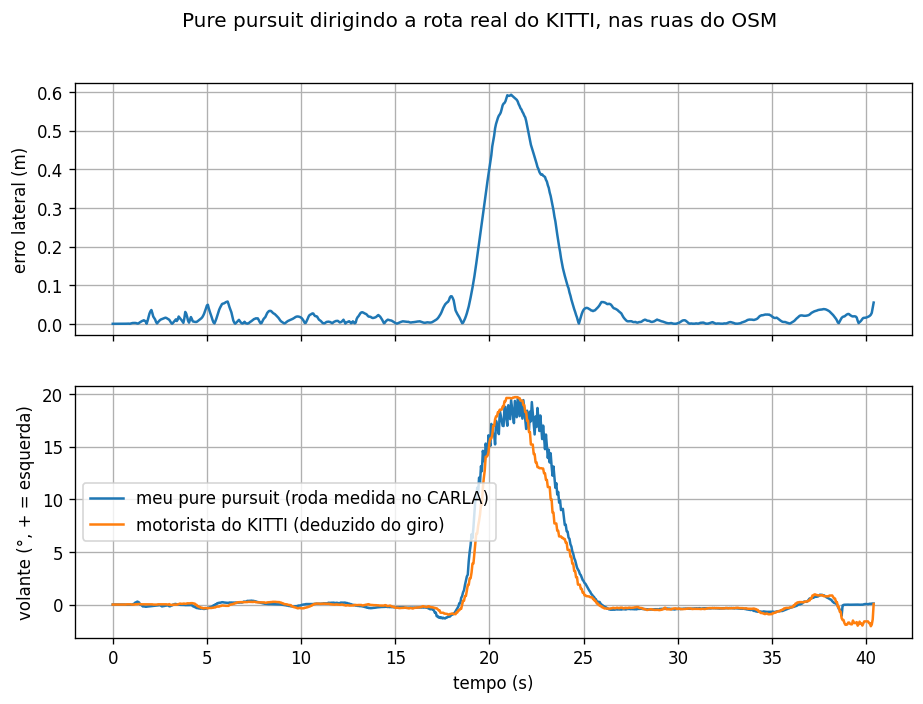
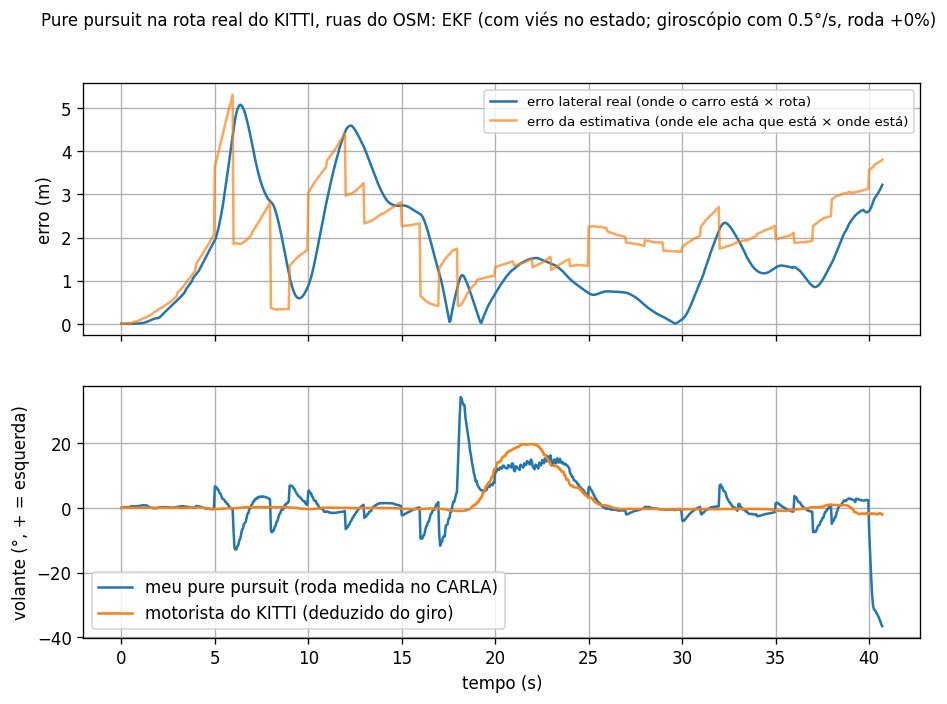

# Autonomous car, built one piece at a time

A self-driving stack I built from first principles to understand (and be able to explain) every decision: vehicle model → control → speed and grip → noise and filtering → LiDAR → learned drivers → real sensor data (KITTI) → CARLA on real streets (OpenStreetMap).

Every step is a small closed-loop experiment with a number at the end. Every constant either comes from physics or a source, or is marked as a guess.

> Code comments and plot labels are in Portuguese (my native language). The numbers speak for themselves.



## Results at a glance

| Step | What I built | Result |
|---|---|---|
| 1. Kinematic bicycle | `sim/bicicleta.py` | Locked steering at 17°, wheelbase 0.33 m → radius 1.07 m, the same at 1 and 2 m/s (the kinematic model has no tire slip) |
| 2. Line following | `sim/reta.py` | P control alone oscillates forever. PD settles; the critical damping gain comes from a mass-spring analogy: k_θ = 2√(k_y·L) ≈ 1.15 |
| 3. Pure pursuit + actuation delay | `sim/pure_pursuit.py` | Without delay the best lookahead is 0.3 m (2.5 cm error). With a 0.2 s delay that same lookahead degrades to 15.6 cm, and the best becomes 1 m (3.8 cm) |
| 4. Speed profile + tire grip | `sim/velocidade.py` | v = min(v_max, √(μg/κ)) with μ from f1tenth_gym: 4.26 s/lap, 22% faster than the best constant speed |
| 5. Noise + filtering | `sim/ruido.py` | Raw noisy position makes steering jitter about 40×. A moving average lags (4× the error). A predict-correct filter gets 2.5 cm vs 2.2 cm noise-free |
| 6. LiDAR wall centering | `sim/lidar.py` | Laps with no map, but ~13 cm steady-state error toward the outside of curves |
| Imitation learning | `sim/imitacao.py`, `sim/pista_nova.py` | MLP (LiDAR → steering) matches the expert on the training oval. On an unseen track, error grows to 21.7 cm vs 7.9 cm, almost all on right turns (distribution shift). **Mirroring the data** (flip scan, negate steering) brings it to 7.8 cm with no new data |
| Neuroevolution | `sim/evolucao.py`, `sim/varredura.py` | No expert: steering + speed from scratch. **All 12 runs (4 penalty weights × 3 seeds) beat the expert**: mean ~3.64 s/lap vs 4.26 s. They find the racing line |
| Reward shaping | `--punicao N` | Penalizing wall proximity cuts time-near-wall from 7–54% to 1–3% for ~2–3% lap time. Weights 5 and 20 are indistinguishable. Surprise: unpenalized champions completed the unseen track 3/3, penalized only 5/9 (small sample, cause untested) |
| **Real data: dead reckoning** | `real/kitti.py`, `real/estimativa.py` | KITTI drive 0009 (332 m, 46 s, real car): integrating speed + yaw rate from a lab-grade IMU drifts 2.5 m (0.8%). With a simulated consumer sensor (2% scale, 0.5°/s gyro bias): 36.6 m |
| **Real data: EKF** | `real/estimativa.py` | Degraded GPS (σ 3 m, 1 Hz) fused with motion: RMSE 1.33 m vs 4.13 m for GPS alone and 2.13 m blind (mean of 20 noise draws). With the consumer sensor the EKF only matches GPS (4.06 m) because gyro bias is not in the state yet → next step |
| CARLA physics | `carla_sim/circulo.py` | Same locked-steering test with real tire physics: radius grows 7.0 → 7.6 m from 10 to 30 km/h (unlike the kinematic model); loses grip at 50 km/h |
| CARLA, self-localizing | `osm_kitti.py --localizar` | The car no longer asks the simulator where it is: same EKF as on KITTI, fed with simulated 3 m GPS at 1 Hz, noisy wheel speed and a gyro with 0.5°/s bias. Lateral error on straights goes from 1 cm (perfect pose) to **1.34 m median, 5 m max, beyond half a lane 43% of the time**. The car tracks its *belief* well; the belief is off by ~1.9 m. The bias is learned (0.55–0.59°/s vs 0.5 true). Each GPS fix jolts the steering. Lesson: GPS-grade localization cannot keep a lane; real cars localize against lane markings or a map |
| CARLA on real streets | `carla_sim/osm_kitti.py` | Karlsruhe streets from OpenStreetMap loaded into CARLA; pure pursuit follows the route the KITTI car drove, at its speed. **My steering tracks the human driver's** (inferred from yaw rate): RMS difference 1.05°, peak 19.5° vs 19.7°, no time lag. Lateral error 1.4 cm mean on straights (max 7 cm), 59 cm peak in the 74° turn, where pure pursuit cuts the corner (4 m lookahead). A first run showed a fake 0–0.5 m sawtooth because I measured distance to route *points* (~1 m apart) instead of segments |

## Highlights

**Learning from failure.** The imitation network looked perfect on the training track and failed on right turns on a new one. Mirroring fixed it without collecting new data:



**Evolution finds the racing line by itself** (200 cars per generation, generations 1 → 30). Video: [docs/media/evolution.mp4](docs/media/evolution.mp4)



**A real car in Karlsruhe** (KITTI): LiDAR scans placed with the reference pose. Sharp walls mean the pose, the calibration and the projection are all consistent.



**My controller vs a human driver**, same street, same speed. Video: [docs/media/carla_osm_kitti.mp4](docs/media/carla_osm_kitti.mp4)



**Same car, but now it has to figure out where it is** (EKF with noisy GPS). Blue = where it really is vs the route; orange = how wrong its own estimate is. The car follows its belief, so its error follows the filter's:



**Even ground truth has error.** On the short drive 0005, the OXTS unit's own velocity integrates to 71.2 m while its positions add up to 69.4 m (~2.5% disagreement). On the longer drive 0009, dead reckoning with the same IMU ends only 0.8% off, so the gap looks specific to that segment. Cause still open.

## How to run

```bash
python -m venv .venv && .venv/bin/pip install -r requirements.txt

# simulation (2D, runs on a laptop, no GPU)
.venv/bin/python sim/pure_pursuit.py --atraso 0.2
.venv/bin/python sim/imitacao.py --espelhar
.venv/bin/python sim/evolucao.py --punicao 5 --semente 1
.venv/bin/python sim/varredura.py          # 12 runs, ~12 min

# real data (KITTI raw, download separately into data/kitti/, see below)
.venv/bin/python real/kitti.py 2011_09_26_drive_0009
.venv/bin/python real/estimativa.py 2011_09_26_drive_0009
```

**KITTI data:** from the [KITTI raw dataset](https://www.cvlibs.net/datasets/kitti/raw_data.php), get `2011_09_26_calib.zip` and `2011_09_26_drive_0009_sync.zip` (the images are not needed) and unzip into `data/kitti/`.

**CARLA:** tested with CARLA 0.9.16 and Python 3.10 on Windows + RTX. `pip install carla==0.9.16`, open the simulator, then `python carla_sim/circulo.py` or `python carla_sim/osm_kitti.py --dirigir --video`.

## Structure

```
sim/         2D simulation: vehicle model, controllers, LiDAR, learned drivers
real/        real sensor data (KITTI): dead reckoning, EKF
carla_sim/   CARLA experiments and the OpenStreetMap map of the KITTI area
docs/        glossary (Portuguese), figures, video
```

## Next

- Gyro bias in the EKF state (the consumer-sensor case)
- LiDAR scan matching (ICP) as odometry
- Localize against the lane or a map (camera lane detection or LiDAR scan matching), not GPS
- Stop cutting the corner: lookahead tied to curvature, or a Stanley / MPC controller
- A real 1/10 scale car: same model, sim to real

## Credits and licenses

- Map data © [OpenStreetMap](https://www.openstreetmap.org/copyright) contributors, available under the Open Database License (ODbL). File: `carla_sim/mapas/karlsruhe_kitti.osm`.
- KITTI raw data: A. Geiger, P. Lenz, C. Stiller, R. Urtasun, "Vision meets Robotics: The KITTI Dataset", IJRR 2013. Licensed [CC BY-NC-SA 3.0](https://creativecommons.org/licenses/by-nc-sa/3.0/). The route in `carla_sim/mapas/kitti_0009_rota.csv` is derived from it, under the same license.
- Tire friction coefficient from [f1tenth_gym](https://github.com/f1tenth/f1tenth_gym). Evolution inspired by "Deep Cars" by Universo Programado.
- [CARLA](https://carla.org/) simulator.
